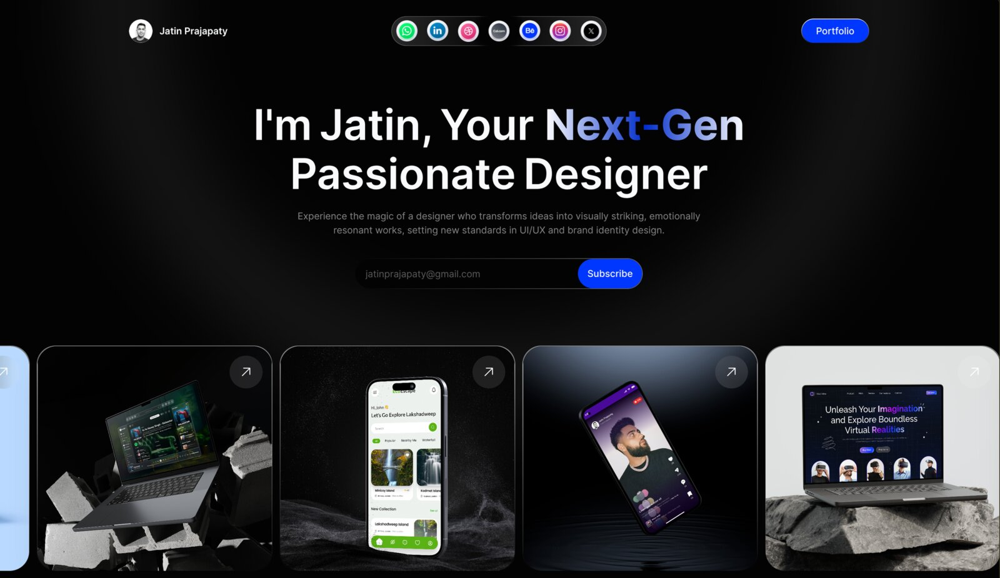

# designer

A portfolio website for a product designer, built with **Next.js 14**, **TypeScript**, **Tailwind CSS** and **Framer Motion**. It has an animated preloader, a macOS-style dock for navigation, light/dark themes and a gallery of design work linking out to Dribbble.



## Run locally

You need Node.js 18+ and pnpm.

```bash
git clone https://github.com/tejassharma-ts/designer.git
cd designer
pnpm install
pnpm dev
```

Open http://localhost:3000. Use `pnpm build && pnpm start` for a production build.
